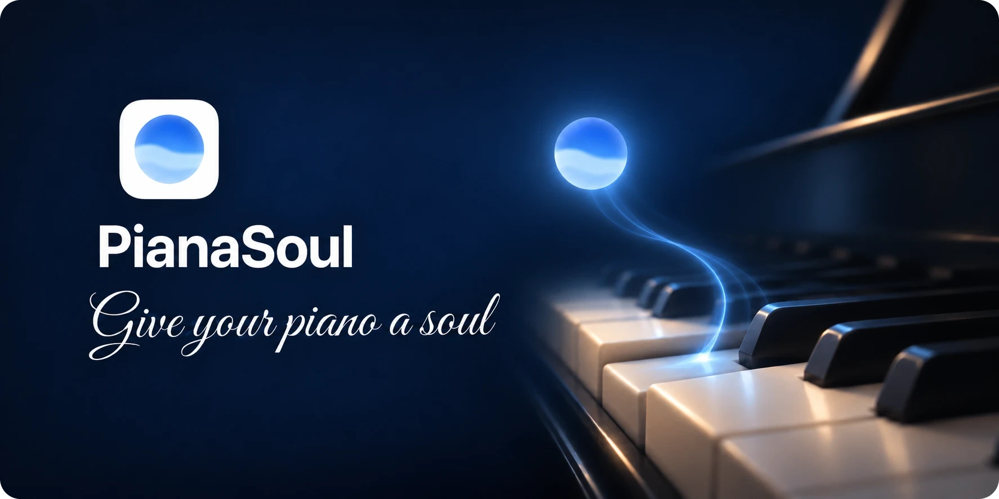
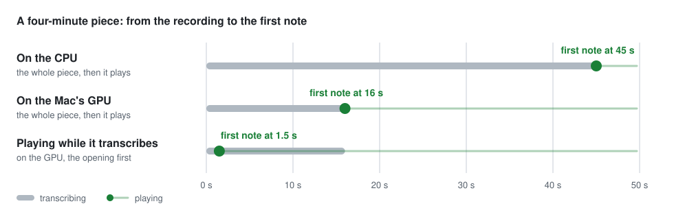

<h1 align="center">PianaSoul</h1>

  

  <a href="https://pianasoul.kaisenyao.com/demo/"><picture><source media="(prefers-color-scheme: dark)" srcset="docs/demo-button-dark.svg"></picture></a>&nbsp;&nbsp;&nbsp;&nbsp;
  <a href="https://github.com/kaisenyao/PianaSoul/releases/latest/download/PianaSoul.dmg"><picture><source media="(prefers-color-scheme: dark)" srcset="docs/download-button-dark.svg"></picture></a>

  
  
  

## What it does

PianaSoul runs on a Mac, quietly, in the menu bar. The Mac keeps your library and plays the piano; everything else
happens on your phone.

- **Your library, on your phone.** A folder of MIDI files on the Mac, with search, artists, favorites and playlists.
- **It plays your piano.** A digital piano over USB or Bluetooth, a sound app such as Pianoteq, or, with no piano at
  all, Built-in Piano through the Mac's own speakers.
- **She finds what you don't have.** Ask for a piece, and she finds a real piano performance on YouTube or Bilibili
  and turns it into MIDI. It starts to play a few seconds later.
- **Talk to her.** Tap the orb and say what you would like to hear, or type it in a chat. She is Jasmine
  ("Xiǎomíng Tóngxué" in Chinese), and she answers in your language.

The first two need no key and no account. The last two are the advanced features, which you turn on when you want
them.

## Hear it

Glenn Gould's rehearsal of Bach's Partita No. 2 in C minor, from the
[Glenn Gould Official Channel on YouTube](https://www.youtube.com/watch?v=WqwZC-yLYI4), beside PianaSoul's
transcription of it ([the MIDI file](docs/gould-partita-2-rehearsal.mid)): no manual edits. The sound switches
between the two every ten seconds.

https://github.com/user-attachments/assets/2e5009ee-f0c6-435c-9534-d49df65b70ed

## Using it

  &nbsp;&nbsp;&nbsp;
  &nbsp;&nbsp;&nbsp;
  

- **Play.** Tap a piece in the library, and the piano plays it. The player shows its notes going by, or a piano with
  its keys going down.
- **Ask.** Tap the orb and say what you would like, or type it in a chat. She plays pieces and playlists, pauses,
  goes on, and makes it louder or softer.
- **Add.** The + in the library adds MIDI files from the phone, or searches online by name or with a video link.
- **Put the phone down.** The Mac plays the piano and the phone is its remote control: lock it, and the music goes
  on.

## Technical highlights

Three things we worked out so that "play me this" becomes a piano that starts a few seconds later and keeps its
rhythm.

### Notes land on time

Wi-Fi delivers notes unevenly, which breaks the rhythm. So over Wi-Fi each note leaves the Mac a moment early,
together with the time it should sound, and the iPad plays it on time:

  <picture>
    <source media="(prefers-color-scheme: dark)" srcset="docs/timing-dark.svg">
    
  </picture>

USB and Bluetooth deliver notes evenly, so a piano connected that way plays them at once.

### Transcribed on the Mac's GPU

Turning a recording into MIDI is the slow step. PianaSoul runs it on the Mac's own GPU, about three times as fast
as on the CPU: a minute of music takes about four seconds on an M1 Max. The recording never leaves the Mac for it,
and if the GPU fails in the middle of a piece, the CPU carries on from the same place.

### It plays while it transcribes

A whole piece would still mean a wait. So the piano starts as soon as the opening is ready, and the rest is
transcribed ahead of the playing, many times faster than the music moves. What you hear is note for note what the
finished file holds.

  <picture>
    <source media="(prefers-color-scheme: dark)" srcset="docs/first-note-dark.svg">
    
  </picture>

[PianaSoul Basic](#pianasoul-basic) has the rest of how it works.

## Get started

You need a Mac with Apple silicon and macOS 15 or later, and a phone on the same Wi-Fi: an iPhone, or an Android
phone with Chrome. To look around first, [try the demo](https://pianasoul.kaisenyao.com/demo/) in your browser.

1. [Download PianaSoul](https://github.com/kaisenyao/PianaSoul/releases/latest/download/PianaSoul.dmg), open the DMG
   and drag PianaSoul to the Applications folder.
2. Open it. The first time, macOS stops it because it isn't notarized by Apple: click Done, not Move to Trash. Then
   in System Settings › Privacy & Security, click Open Anyway near the bottom, and Open Anyway again.
3. PianaSoul walks you through the rest: your library's folder, your piano, and two codes to scan with your phone.

She needs a key of your own, from OpenAI or Alibaba Cloud Model Studio; nothing else does.
[How to get each key](docs/keys.md), step by step.

## PianaSoul Basic

The app is not open source, but how it works is: [PianaSoul Basic](basic), the basic edition, is source code under
the MIT license that you can read, build and run from Terminal. It transcribes recordings, keeps a library, plays
your piano, and she is there too.

The technical side is written up there: [how a request becomes music](basic/docs/how-it-works.md),
[how to set the timing yourself](basic/README.md#timing), and
[how she hears her name](basic/docs/voice.md).

## Questions and answers

### Before you install

<dl><dd>

<b>Is it free? Is it open source?</b>

PianaSoul is free. The Mac app with its phone app is not open source; PianaSoul Basic, in [`basic/`](basic), is,
under the MIT license.

</dd></dl>

<dl><dd>

<b>Do I need a digital piano?</b>

No. With no piano at all, Built-in Piano plays a sampled grand through the Mac's own speakers. To play a piano of
your own, it has to take MIDI, over USB or Bluetooth; an iPad or a Mac with a sound app such as Pianoteq works too.

</dd></dl>

<dl><dd>

<b>Do I need an API key or an account?</b>

Not for your library, your piano, or Online Search & Transcription. Only she needs a key of your own:
[how to get each key](docs/keys.md).

</dd></dl>

<dl><dd>

<b>Does it run on an Intel Mac? On Android?</b>

The Mac app needs Apple silicon and macOS 15 or later. The phone app is made for iPhone, in Safari or on the Home
Screen, and also runs in Chrome on Android.

</dd></dl>

<dl><dd>

<b>How good is a transcription?</b>

It works best on solo piano: some notes may be missed or added, and the sustain pedal is either down or up.
Recordings are limited to 60 minutes. Download only videos you are permitted to download.
[Hear one](#hear-it) beside its original.

</dd></dl>

<dl><dd>

<b>How does it update?</b>

PianaSoul checks for a new version once a day and when you choose Check for Updates in the Mac app's Settings ›
About, and installs it when you say so. What you allowed it, the keychain and Bluetooth, stays allowed through
updates.

</dd></dl>

<dl><dd>

<b>Where does my data go?</b>

Your library, your chats and your settings stay on your Mac, and the phone talks only to your Mac, on your own
network: nothing goes through a server of ours. What you say to her goes to the services you chose, with your own
keys; searches go to YouTube and Bilibili.

</dd></dl>

### When something goes wrong

<dl><dd>

<b>macOS says PianaSoul can't be opened</b>

That is expected the first time, because the app isn't notarized by Apple. Click Done, then follow
[Get started](#get-started), step 2.

</dd></dl>

<dl><dd>

<b>Nothing sounds</b>

The Mac app's menu and Settings › Piano say what it sees, and Test plays a few notes. An iPad drops out of a network
session when its sound app closes or the Mac sleeps: connect it again in Audio MIDI Setup.

</dd></dl>

<dl><dd>

<b>The phone says Mac Not Connected</b>

The Mac is asleep or off, PianaSoul is not running, or the two are not on the same Wi-Fi.

</dd></dl>

<dl><dd>

<b>A search can't reach YouTube</b>

Bilibili's results still come. In China mainland, turn YouTube off under Sources in the phone's Settings.

</dd></dl>

<dl><dd>

<b>Something else</b>

Use Send Feedback in the phone's Settings, [open an issue](https://github.com/kaisenyao/PianaSoul/issues/new/choose),
or write to [pianasoul@kaisenyao.com](mailto:pianasoul@kaisenyao.com).

</dd></dl>

## License and credits

PianaSoul, the Mac app with its phone app, is free and not open source. © 2026 PianaSoul. All rights reserved.
PianaSoul Basic, the code in [`basic/`](basic), is open source under the [MIT license](basic/LICENSE), which does
not cover the name PianaSoul or its icon.

The app is built on open-source work, with thanks to [Transkun](https://github.com/Yujia-Yan/Transkun) for
transcription (its pretrained weights, trained on the MAESTRO dataset, are for non-commercial use),
[sherpa-onnx](https://github.com/k2-fsa/sherpa-onnx) and [Silero VAD](https://github.com/snakers4/silero-vad) for
hearing her, the Salamander Grand Piano by Alexander Holm (CC BY 3.0) for Built-in Piano, Mitch Ivin's
[ipod-classic](https://github.com/mitchivin/ipod-classic) for the classic player, and
[Sparkle](https://sparkle-project.org) for updates. Every license is included in the app, and listed in its
Settings › About › Acknowledgments.
