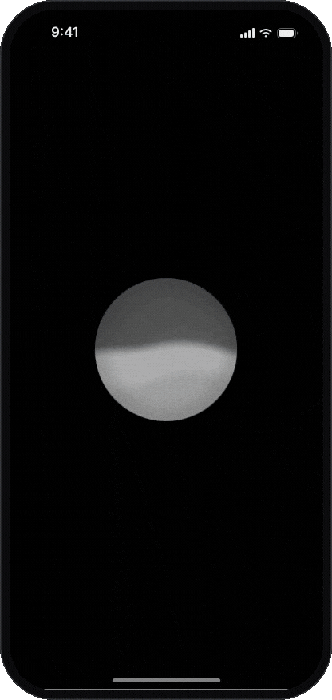
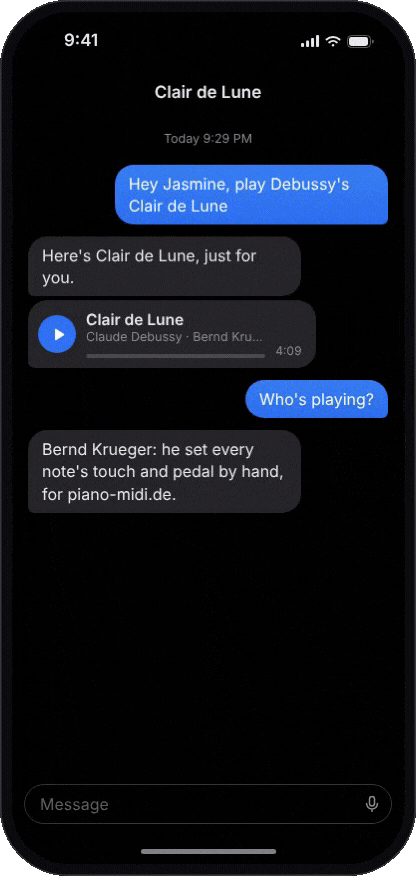
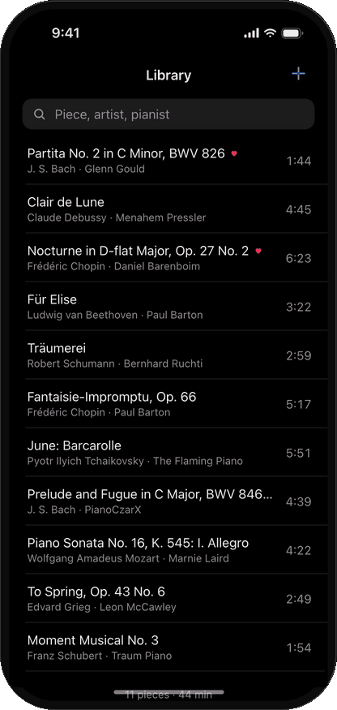
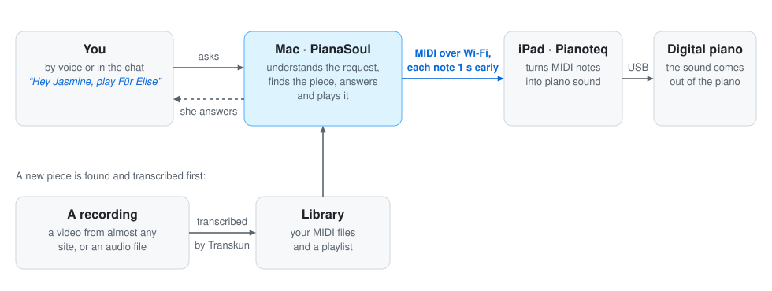
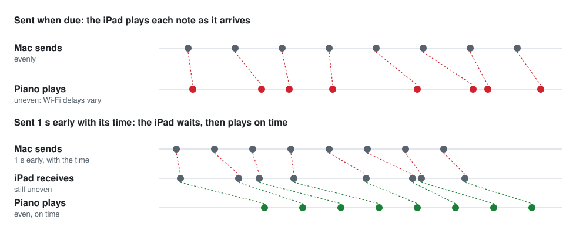

<h1 align="center">PianaSoul</h1>

<p align="center">
  <picture>
    <source media="(prefers-color-scheme: dark)" srcset="docs/tagline-dark.svg">
    
  </picture>
</p>

<p align="center">
  Ask her for a piece by voice or in a chat, and she plays it on your piano.<br>
  If it is not in your library yet, she finds a performance online and turns it into MIDI first.
</p>

<br>

<p align="center">
  &nbsp;&nbsp;&nbsp;
  &nbsp;&nbsp;&nbsp;
  
</p>

<br>

<p align="center">
  <a href="https://pianasoul.kaisenyao.com"><picture><source media="(prefers-color-scheme: dark)" srcset="docs/demo-button-dark.svg"></picture></a>
</p>

<br>

## What it does

- **Talk to her.** Tap the orb in the iPhone app, or say "Hey Jasmine" (or her Chinese name, "Xiǎomíng Tóngxué")
  to the Mac. You can also type in a chat. She is one assistant everywhere, and answers in your language.

- **She plays your piano.** Notes and pedal go over MIDI, like someone playing a MIDI keyboard: to Pianoteq on an
  iPad that drives a digital piano, to the piano itself over Bluetooth or USB, or to Pianoteq on the Mac.

- **She finds what you don't have.** She looks on YouTube and Bilibili at once (either can be turned off in the
  app) for a real piano performance (no tutorials or falling notes) and turns it into MIDI with
  [Transkun](https://github.com/Yujia-Yan/Transkun): notes, timing, dynamics and pedal. Your own recordings work
  too. This happens in the background, so you can keep talking with her; the piece plays once it is ready, unless
  you have chosen something else meanwhile, and then she tells you it is ready.

- **Your library is a folder on your Mac.** Put MIDI files in `~/Music/PianaSoul`, in Finder or from the phone, and
  they are in the app at once, with favorites, recently played and search. The basics need no key at all.

<br>

<p align="center">
  <picture>
    <source media="(prefers-color-scheme: dark)" srcset="docs/how-it-works-dark.svg">
    
  </picture>
</p>

<br>

## Hear a transcription

Glenn Gould's rehearsal of Bach's Partita No. 2 in C minor, BWV 826, from the
[Glenn Gould Official Channel on YouTube](https://www.youtube.com/watch?v=WqwZC-yLYI4), and PianaSoul's transcription of
it ([the MIDI file](docs/gould-partita-2-rehearsal.mid)) played by Pianoteq 9 on an iPad: default settings, no
manual edits. They play side by side, and the sound switches between them every ten seconds.

<video src="https://github.com/user-attachments/assets/037fc112-9d36-47ac-b44a-c47c4e3aa064" width="100%" controls></video>

<br>

## Setup

A Mac app for PianaSoul is in development and in private beta. Until it is released, the steps below run
PianaSoul from source.

You need a Mac and a piano that takes MIDI (or Pianoteq). For her you also need an OpenAI API key, or a Qwen one where
OpenAI is out of reach; new pieces from YouTube or Bilibili need none (without one, they are named from the video's title). Steps 1 to 4 get the piano playing; 5 and 6 add the iPhone app and her voice on the Mac.

### 1. Install

You need Python 3.10 or later, or [uv](https://docs.astral.sh/uv/). If you installed uv with its install script,
put it on your PATH:

```bash
echo 'export PATH="$HOME/.local/bin:$PATH"' >> ~/.zshrc
source ~/.zshrc
```

Setup also installs [Deno](https://deno.com), which YouTube's pages need, with the rest.

Then, in the project folder:

```bash
./setup.sh
```

It creates `.venv`, installs what she needs, and checks that the transcription model loads. Run it again after each
`git pull`: it updates `.venv` in place.

If an earlier version kept your library in the project's `output/` folder, the first run copies it to the new places
(see Your library) and leaves `output/` as it was, with a note in it. `./run.sh migrate --from output` does the same by
hand.

### 2. Add your keys

Keys go in `~/.zshrc`, never in the repository.

- `OPENAI_API_KEY`, for understanding requests and speech: [platform.openai.com](https://platform.openai.com) >
  API keys.

```bash
echo 'export OPENAI_API_KEY="..."' >> ~/.zshrc
source ~/.zshrc
```

Where OpenAI is out of reach, as in mainland China, Qwen does both instead, on Alibaba Cloud Model Studio: create an
API key there ([how](https://www.alibabacloud.com/help/en/model-studio/get-api-key); not a Coding Plan key, which
starts with `sk-sp-`) and set

```bash
echo 'export PIANASOUL_MODEL=qwen' >> ~/.zshrc
echo 'export DASHSCOPE_API_KEY="..."' >> ~/.zshrc
source ~/.zshrc
```

A key works only in the region it was made in. Beijing is the default; for a key made in Singapore, also set
`DASHSCOPE_REGION=singapore`.

Finding pieces online needs no key. Without her key the app still runs: your library, the player, uploads and online
search work, and she is off until a key is set.

### 3. Connect the piano

The usual way is Pianoteq on an iPad that is connected to a digital piano. The Mac reaches the iPad over Wi-Fi:

1. Open Pianoteq on the iPad.
2. On the Mac, open Audio MIDI Setup, choose Window > Show MIDI Studio, and click the globe.
3. Under My Sessions, click +, name the session `PianaSoul` and tick it.
4. Select the iPad under Directory and click Connect.
5. In Pianoteq on the iPad, turn on the network session as a MIDI input.
6. For the volume control: in Pianoteq, touch and hold the Volume slider, then ask her for "softer" (or move the
   app's volume bar). Keep it with Options > MIDI > Save as, then Set as default.

`./run.sh play --ports` lists every MIDI output with its kind and whether it is connected. If it lists the session as
`Network RTP Session 1`, add `export PIANASOUL_PORT="Network RTP Session 1"` to `~/.zshrc`.

<details>
<summary>Other ways: the piano's own sound over Bluetooth or USB, or Pianoteq on the Mac</summary>
<br>

- **Bluetooth:** turn on Bluetooth MIDI on the piano. In Audio MIDI Setup > Window > Show MIDI Studio, click the
  Bluetooth button, then Connect next to the piano. Pair it there, not in System Settings.
- **USB:** connect the Mac to the piano's USB port.
- **Pianoteq on the Mac:** in Audio MIDI Setup > Window > Show MIDI Studio, double-click IAC Driver and tick
  "Device is online". In Pianoteq, turn on "IAC Driver Bus 1" as a MIDI input.

Then keep part of your output's name in `~/.zshrc`. A Roland FP-40, for example, shows up as `FP-40 MIDI Bluetooth`
over Bluetooth and as `Roland Digital Piano` over USB. These connections need no lead time, and get none (see
Timing):

```bash
./run.sh play --ports
echo 'export PIANASOUL_PORT="FP-40"' >> ~/.zshrc
source ~/.zshrc
```

</details>

### 4. Try it

```bash
./run.sh play docs/gould-partita-2-rehearsal.mid
```

It prints `Playing on …`, and the piano starts within about a second. Control+C stops it. Then ask her in a chat:

```bash
./run.sh chat
```

### 5. The iPhone app

The Mac and the iPhone need the same Wi-Fi. Safari allows the microphone only over trusted HTTPS, so the Mac makes
its own small certificate authority, which the iPhone trusts once.

1. Start it with `./run.sh app`. It prints the app's address, such as `https://192.168.1.20:8765/#token=...`.
   If macOS asks whether Python may accept incoming connections, allow it.

2. The first start shows `PianaSoul-CA.cer` in Finder. AirDrop it to the iPhone and install it in
   Settings > General > VPN & Device Management. Then turn on full trust for it in
   Settings > General > About > Certificate Trust Settings. Or open `http://192.168.1.20:8764/` (the Mac's address,
   port 8764) on the phone: that page has the certificate and the steps for iPhone and Android. To be sure the
   certificate is your Mac's, compare the fingerprint the first start prints with the one in the phone's certificate
   details.

3. Open the printed address in Safari on the iPhone and choose Share > Add to Home Screen. Open the app, tap the orb
   and allow the microphone.

From then on, start `./run.sh app` and open the app. If the router gives the Mac a new address, add the new one to
the Home Screen, or reserve the Mac's address in the router.

For her own voice, add an [ElevenLabs](https://elevenlabs.io) key and the ID of a voice under My Voices; without
them, the Mac's own voice speaks. She understands whatever language you speak.

```bash
echo 'export ELEVENLABS_API_KEY="..."' >> ~/.zshrc
echo 'export PIANASOUL_VOICE_ID="..."' >> ~/.zshrc
source ~/.zshrc
```

Or let Qwen speak for her, on Alibaba Cloud Model Studio. Her voice has a key of its own, which may be the same key as
her model's:

```bash
echo 'export PIANASOUL_VOICE=qwen' >> ~/.zshrc
echo 'export DASHSCOPE_VOICE_API_KEY="..."' >> ~/.zshrc
source ~/.zshrc
```

Her Qwen voice is `longanhuan_v3.1`; `PIANASOUL_VOICE_ID` may name another of the
[voices](https://www.alibabacloud.com/help/en/model-studio/qwen-audio-tts-voice-list) of `qwen-audio-3.1-tts-flash`.
For a key made in Singapore, also set `DASHSCOPE_VOICE_REGION=singapore`.

<details>
<summary>What to keep private, and how to start afresh</summary>
<br>

The address's token, `pairing.json` and the `.pem` files in the data folder (`~/Library/Application Support/PianaSoul`)
are private. With the token, anyone on your Wi-Fi could use the app; the app trades it once for a cookie that only its
own pages send. The certificate authority can only vouch for `.local` names and home network addresses, and the `.cer`
file holds no secret. `pairing.json` has the address, the token and the certificate's fingerprint, for the Mac app.

To start afresh, delete `phone-token` in the data folder (a new address to add to the Home Screen) or `phone-tls/`
(a new certificate to install). For another iPhone,
`open -R ~/Library/Application\ Support/PianaSoul/phone-tls/PianaSoul-CA.cer` shows the file again.

</details>

### 6. Her voice on the Mac (optional)

To talk to her through the Mac's own microphone and speakers:

```bash
uv pip install --python .venv/bin/python -e ".[voice]"
./run.sh voice
```

The first run asks for the microphone and downloads two small models (about 34 MB). A Mac mini needs an external
microphone; choose it in System Settings > Sound.

<br>

## Using it

The app, voice and chat are one assistant, with one library and one set of conversations. Run one of them at a time.

- **The iPhone app.** Tap the orb and she comes on in color: say what you would like, no name needed the first time
  (a piece playing pauses while she listens, as it does for her name). After that, say her name before a new request;
  a follow-up within six seconds of her reply needs none, unless the piano is playing: its sound would be taken for
  speech. Tap again and she is gray, which is off. Drag right from the orb for the library, your playlists and her conversations, left for the
  player. Make a playlist from any piece (touch and hold it, then Add to Playlist), and play it from its page or by
  asking her ("play my bedtime playlist"). She can also play the pieces of a conversation again, in their order
  ("play this chat's songs again"), keep them as a playlist that she names, and rename a playlist when asked.
  Settings > How to Use explains the rest.

- **Voice.** Say "Hey Jasmine" (or "Xiǎomíng Tóngxué"), then a piece: "Hey Jasmine, play Clair de Lune". "Stop",
  "continue", "start over", "next", "previous", "louder", "softer" and "bye" act at once, in English or Chinese. A
  piece she chooses plays on its own; in a playlist, "next" past the last piece starts it again from the first.

- **Chat.** Run `./run.sh chat` and ask in any language: "Chopin's Nocturne Op. 9 No. 2 by Rubinstein", "something
  gentle by Debussy", a video link, or a path to your own recording. `/help` lists the commands.

- **The command line.**
  - `./run.sh play clair de lune` plays the best match in the library; `--all` plays everything.
  - `./run.sh song.mp3` transcribes an audio file, or a folder of them, into the library.
  - `./run.sh` transcribes the video links in `tasks.csv`, one per row.
  - `./run.sh library list` lists the library; `library import <folder>` copies MIDI files into it.
  - `./run.sh migrate --from output` copies a library kept in `output/` by an earlier version to the new places.
  - `./run.sh --help` lists the transcription options, such as `-o` to write elsewhere and `--overwrite`.

<br>

## Reference

### Settings

Set these in `~/.zshrc`.

- `OPENAI_API_KEY`: the chat model and speech recognition.
- `DASHSCOPE_API_KEY`: the same with Qwen (`PIANASOUL_MODEL=qwen`), and `DASHSCOPE_REGION` the region the key was
  made in: `beijing` (the default) or `singapore`.
- `PIANASOUL_VOICE`: her voice: `elevenlabs`, `qwen` or `mac`. Without it, ElevenLabs once its key and a voice are
  set, and the Mac's own voice until then.
- `ELEVENLABS_API_KEY` and `PIANASOUL_VOICE_ID`: her ElevenLabs voice.
- `DASHSCOPE_VOICE_API_KEY`: her Qwen voice (`PIANASOUL_VOICE=qwen`), with a key of its own; `DASHSCOPE_VOICE_REGION`
  the region the key was made in, `beijing` (the default) or `singapore`; and `PIANASOUL_VOICE_ID` the voice's name,
  by default `longanhuan_v3.1`.
- `PIANASOUL_TRANSCRIBE`: `0` turns transcription and online search off though the advanced extra is installed, with
  her still on (the Mac app's Online Search & Transcription).
- `PIANASOUL_PORT`: the MIDI output, by part of its name, until one is chosen in the Mac app. Default `pianasoul`.
- `PIANASOUL_LEAD`: seconds each note leaves early (see Timing). Default `1` for a network session, `0` otherwise.
- `PIANASOUL_MUSIC`, `PIANASOUL_DATA` and `PIANASOUL_CACHE`: other places for the library folder, its data and work
  files (see Your library).
- `PIANASOUL_MODELS`: a folder with the wake word and voice activity models, laid out as `models/` in the data folder
  is (the Mac app brings its own). They are read from there as they are, and never downloaded.
- `PIANASOUL_WAKE_THRESHOLD`: how readily she hears her name; lower hears more. Default `0.2`.
- `PIANASOUL_MODEL`: the chat model: `openai`, `qwen` or `anthropic`, alone or with a model after a colon. Default
  `openai:gpt-6-luna`; `qwen` is `qwen3.8-flash`, and Qwen's `qwen-audio-3.1-asr-flash` then hears her requests.
- `PIANASOUL_STT_MODEL`: OpenAI's speech recognition model. Default `gpt-transcribe`.
- `PIANASOUL_TTS_MODEL`: the ElevenLabs model. Default `eleven_v4_turbo`; `eleven_v4` is richer and slower.

### Volume

The app's volume bar, or asking her for "softer" or "volume to half", sets MIDI volume (controller 7). It takes
effect at once, is kept between runs, and is sent again before every piece. It starts at 80%. Pianoteq follows it
once it is set up to (step 6 of Connect the piano).

### Timing

Wi-Fi delivers notes unevenly, which breaks the rhythm. So each note leaves the Mac one second early, together with
the time it should sound, and the iPad plays it on time:

<p align="center">
  <picture>
    <source media="(prefers-color-scheme: dark)" srcset="docs/timing-dark.svg">
    
  </picture>
</p>

In return, playing, pausing, stopping and a change of volume take about a second: with a lead, every message
carries its time, since an iPad plays a note stamped for later at once when it arrives with one stamped for now. Bluetooth and USB deliver notes evenly, so a piano
connected that way gets no lead and answers at once. `PIANASOUL_LEAD` sets the lead in seconds for every output: `2`
for an unsteady network, `0.5` for quicker responses.

### When something goes wrong

- **Nothing sounds:** check the connection. The iPad drops out of Participants in MIDI Network Setup when Pianoteq
  closes, the iPad goes offline or the Mac sleeps. Connect it again and ask her to continue; nothing needs a
  restart.
- **A search can't connect to YouTube:** Bilibili's results still come, on the phone and for her. In mainland
  China, turn YouTube off under the search field in Search Online, so that she does not wait for it; she searches
  the sites turned on there. If Bilibili refuses searches, turn off any proxy or VPN.
- **She does not hear her name:** run `./run.sh voice --debug` to see when she hears it, and lower
  `PIANASOUL_WAKE_THRESHOLD` (to `0.15`, say). If she wakes by herself, raise it.
- **Anything else:** chat, voice, the app, play and transcription all take `--debug`, which shows each step with its
  time.

### Limits

Transcription works best on solo piano: there is no separation of voice or accompaniment, so she looks for
piano-led recordings, and some notes may be missed or added. The sustain pedal is either down or up. Recordings are
limited to 60 minutes. Download only videos you are permitted to download; playlists and live streams are not
supported, nor Bilibili videos that are paid for or only for an uploader's supporters. If a site stops working,
update yt-dlp:

```bash
uv pip install --python .venv/bin/python --upgrade 'yt-dlp[default]'
```

### Your library

The library is the folder `~/Music/PianaSoul`. Everything in it, in any subfolder, is in the app: put files in with
Finder or send them from the phone (they go into `Uploaded/`), move and rename them as you like, and the app follows
at once, with each piece's names, favorite and plays. The files are yours: PianaSoul never renames, moves or changes
them, and renaming a piece in the app changes only its name there. The pieces PianaSoul makes go into `Transcribed/`,
named after their titles; a piece's details say how it came (transcribed from a video or a recording, uploaded from a
phone, or put in the folder). A recording you put in the folder (mp3, m4a, wav, flac and the like) is made into a
piece once, when transcription is installed; after that only when you ask. Deleting a piece in the app moves its file
to the Mac's Trash. A file that disappears is only hidden, and is back as it was when it returns.

The artwork and pictures you choose in the app are kept with the music, in `Artwork/`: a piece's by its file's
content, so it follows the file wherever it goes, and an artist's by name. A piece deleted in the app takes its
artwork to the Trash with it. Playlists, their artwork and the descriptions you write are kept with the library's
index in the data folder.

Files in iCloud Drive that are not downloaded are left out until they are. Another folder can be the library (set
`PIANASOUL_MUSIC`); files moved there are recognized by their content.

The library's index, her conversations, the app's settings, the phone's certificates and her voice are in
`~/Library/Application Support/PianaSoul`; downloads and work files are in `~/Library/Caches/PianaSoul`. Everything
stays on this Mac and is never uploaded; back up the library folder and the data folder together.

The project can live on a dedicated Mac mini. To start it from any folder, add
`alias piana="$HOME/Documents/PianaSoul/run.sh"` to `~/.zshrc`, then run `piana app`.

<br>

## How it works

- **Understanding requests and choosing pieces:** OpenAI `gpt-6-luna`, through its API; or Qwen `qwen3.8-flash`,
  through Alibaba Cloud Model Studio's.
- **Speech to text:** OpenAI `gpt-transcribe`, heard as you speak through its realtime API, which also decides
  when you have finished; if that connection fails, the request is uploaded whole once it has ended. With Qwen,
  `qwen-audio-3.1-asr-flash`, the request uploaded whole once it has ended, with your library's names as the words
  to expect.
- **Her voice:** ElevenLabs `eleven_v4_turbo`, through its API; or Qwen `qwen-audio-3.1-tts-flash`, through Model
  Studio's; or the Mac's own voice. Her ready-made lines are recorded once in each voice.
- **A recording to MIDI:** Transkun `2.0.1`, on this Mac.
- **Hearing her name, and telling speech from silence:** sherpa-onnx keyword spotting and Silero VAD, on this Mac.

A request goes: speech recognition, then the assistant with your library, then a check that the piano is there, and
then the notes. A new piece is searched for while you wait, then downloaded and transcribed in the background; it
plays once it is there.

What plays is kept when the service stops (the Mac app quits, the Mac restarts): the next start has the piece paused
where it was heard, with its list, and play goes on from there. The phone shows it paused as soon as the Mac is away.

- **Her words.** What always goes the same way (a control done, a volume step, a notice about the piano, goodbye)
  she says in a ready-made line from `src/pianasoul/lines.py`, recorded once in her voice. Everything else the model
  words.

- **Playing safely.** The model can only play pieces that a library search, a look at your library or a
  transcription returned in the same request, one of the pieces she prepared lately, one of your playlists by its
  name, or the pieces she played in the conversation, so it cannot play something it made up. Short requests such as "stop" are done without the model.

- **Another chat model.** Anthropic can do the chat: set `PIANASOUL_MODEL=anthropic:claude-haiku-5-5` and
  `ANTHROPIC_API_KEY`. Speech recognition still needs `OPENAI_API_KEY`.

<br>

## Development

Offline checks, with no paid APIs, microphone or MIDI device, in throwaway folders (never the real library):

```bash
uv pip install --python .venv/bin/python -e ".[advanced]" httpx
.venv/bin/python -m unittest discover -s tests
for test in tests/test_web_*.js; do node "$test"; done
```

`.venv/bin/python tests/manual_playback_intents.py` checks 26 spoken requests against the real chat model: playing, finding pieces, and keeping company.

<br>

## License and credits

PianaSoul is MIT licensed.

- Transcription uses [Transkun](https://github.com/Yujia-Yan/Transkun), whose pretrained weights were trained on
  the MAESTRO dataset (CC BY-NC-SA 4.0); check those terms before commercial use.
- Her voice uses [sherpa-onnx](https://github.com/k2-fsa/sherpa-onnx) and
  [Silero VAD](https://github.com/snakers4/silero-vad).
- The orb's start and end sounds are based on OpenAI's and are not covered by the MIT license (see
  `src/pianasoul/web/CUE_SOURCES.md`).
- The tagline is set in [Great Vibes](https://fonts.google.com/specimen/Great+Vibes), under the SIL Open Font
  License.
