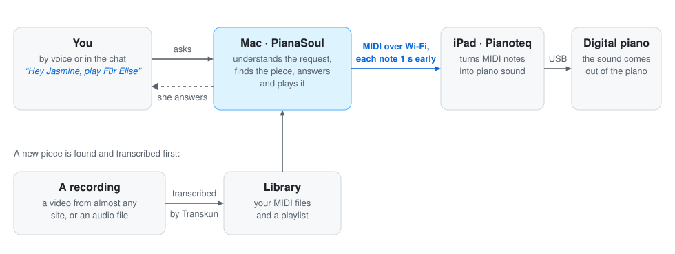
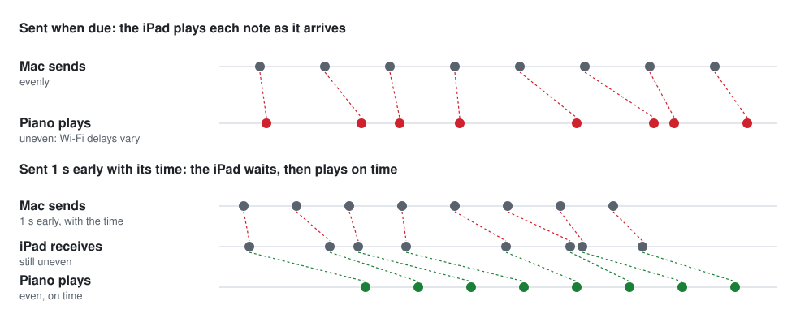

<h1 align="center">PianaSoul Basic</h1>

Piano recordings in, performance MIDI out, and back to a piano: notes, timing, velocity and sustain pedal, kept in a
library you can ask for by chat or by voice.

<p align="center">
  <picture>
    <source media="(prefers-color-scheme: dark)" srcset="../docs/how-it-works-dark.svg">
    
  </picture>
</p>

PianaSoul Basic is the open-source basic edition of [PianaSoul](../README.md): the way it works, as code you can
read, build and run yourself, from Terminal.

- **It transcribes.** A piano recording becomes a performance MIDI file with
  [Transkun](https://github.com/Yujia-Yan/Transkun): a video from YouTube, Bilibili or any other site
  [yt-dlp](https://github.com/yt-dlp/yt-dlp) supports, or an audio file of your own.
- **It keeps a library.** The MIDI files and what is known about them stay in one local folder.
- **It plays your piano.** Notes and pedal go over MIDI: to Pianoteq on an iPad that drives a digital piano, to the
  digital piano's own sound, or to Pianoteq on the same Mac.
- **She is there too.** Ask for a piece in plain language: typed in Terminal, spoken to the Mac, or spoken to an
  iPhone.

### Basic and the app

The [PianaSoul app for Mac](../README.md) is a separate product and is not open source. Nothing here is needed to
use the app, and the app is not needed here.

- **PianaSoul Basic** is set up by hand and runs in Terminal, with your keys in your shell profile.
- **The app** adds a Mac app that installs and updates itself, the phone app with its library, player and chats,
  search across YouTube and Bilibili that starts to play while the rest is still being transcribed, Built-in Piano,
  and setup without Terminal or a shell profile.

## Quick start

1. Install it, on a Mac with Python 3.10 or later, or [uv](https://docs.astral.sh/uv/):

   ```bash
   git clone https://github.com/kaisenyao/PianaSoul.git
   cd PianaSoul/basic
   ./setup.sh
   ```

2. [Connect a piano](#connect-a-piano), then play the demo file that comes with the repository:

   ```bash
   ./run.sh play ../docs/gould-partita-2-rehearsal.mid
   ```

3. [Add your keys](#keys), then ask for a piece:

   ```bash
   ./run.sh chat               # type "play Clair de Lune"
   ./run.sh voice              # or say "Hey Jasmine, play Clair de Lune"
   ```

## Install

Requires Python 3.10+ (or [uv](https://docs.astral.sh/uv/)). Transcription runs on macOS or Linux; playback with
exact timing and the voice assistant are made for macOS. YouTube downloads also need [Deno](https://deno.com), or a
Node.js runtime explicitly enabled for yt-dlp.

```bash
./setup.sh
```

Setup creates `.venv` and an empty `tasks.csv`, and checks that the transcription model loads. ffmpeg comes with a
dependency.

If uv and Deno were installed in their default user directories, keep both on your PATH, and add the line to your
shell profile so new terminals can find them:

```bash
export PATH="$HOME/.local/bin:$HOME/.deno/bin:$PATH"
```

Tip: to run PianaSoul Basic from any folder, add an alias to your profile, for example
`alias psb="$HOME/PianaSoul/basic/run.sh"`, then use `psb chat`, `psb voice` and so on.

## Keys

Keys go in your shell profile (`~/.zshrc` on a Mac), never in the repository. Configure only the services you use:

- `OPENAI_API_KEY`: the chat model and, for voice, speech recognition. From
  [platform.openai.com](https://platform.openai.com) > API keys.
- `YOUTUBE_API_KEY`: finding recordings on YouTube. In the
  [Google Cloud console](https://console.cloud.google.com), enable "YouTube Data API v3", then Credentials > Create
  API key.
- `ELEVENLABS_API_KEY`: her voice (optional, see [Voice](#voice)). From [elevenlabs.io](https://elevenlabs.io),
  under API keys in your account.

```bash
echo 'export OPENAI_API_KEY="..."' >> ~/.zshrc
echo 'export YOUTUBE_API_KEY="..."' >> ~/.zshrc
source ~/.zshrc
```

Transcribing audio to MIDI and playing MIDI files need no key. Without a YouTube key the chat still plays your
library and recordings you link or point it to. Anthropic can stand in for OpenAI as the chat model: see
[Optional chat provider](docs/how-it-works.md#optional-chat-provider).

## Connect a piano

PianaSoul Basic plays by sending notes and pedal over MIDI, like someone playing a MIDI keyboard. Pick one way and
set it up once.

<details>
<summary><b>A. Pianoteq on an iPad</b> (the iPad can stay connected to the piano by USB)</summary>

The notes go from the Mac over network MIDI to the iPad, and from there to the digital piano. Setting:
`PIANASOUL_BASIC_PORT`.

1. Open Pianoteq on the iPad.
2. On the Mac, open Audio MIDI Setup, choose Window > Show MIDI Studio, and click the globe button to open MIDI
   Network Setup.
3. Under My Sessions, click +, name the session `PianaSoul Basic` and tick it. Leave Latency at 0 ms.
4. Select the iPad under Sessions and Directories and click Connect. It now shows under Participants.
5. In Pianoteq on the iPad, enable the network session as a MIDI input.

Run `./run.sh play --ports` and use the actual output name. Depending on macOS, the port may still be called
`Network RTP Session 1` even after changing the session's local name. For that output, add this setting to your
shell profile and open a new terminal:

```bash
export PIANASOUL_BASIC_PORT="Network RTP Session 1"
```

</details>

<details>
<summary><b>B. The piano's own sound, over Bluetooth</b></summary>

Settings: `PIANASOUL_BASIC_PORT` and `PIANASOUL_BASIC_LEAD=0`.

1. Turn on Bluetooth MIDI on the piano (see its manual).
2. On the Mac, open Audio MIDI Setup, choose Window > Show MIDI Studio and click the Bluetooth button. Click Connect
   next to the piano. Pair it here, not in System Settings, which connects Bluetooth audio instead.

</details>

<details>
<summary><b>C. The piano's own sound, over USB</b></summary>

Settings: `PIANASOUL_BASIC_PORT` and `PIANASOUL_BASIC_LEAD=0`.

1. Connect the Mac to the piano's USB port. If an iPad uses that port, unplug it first.

</details>

<details>
<summary><b>D. Pianoteq on the same Mac</b></summary>

Settings: `PIANASOUL_BASIC_PORT=IAC` and `PIANASOUL_BASIC_LEAD=0`.

1. In Audio MIDI Setup > Window > Show MIDI Studio, double-click IAC Driver and tick "Device is online".
2. In Pianoteq, enable "IAC Driver Bus 1" as a MIDI input.

</details>

For B, C and D, find the output's name and keep it in your profile. Any part of the name will do. A Roland FP-40,
for example, shows up as `FP-40 MIDI Bluetooth` over Bluetooth and `Roland Digital Piano` over USB:

```bash
./run.sh play --ports                                       # lists the MIDI outputs
echo 'export PIANASOUL_BASIC_PORT="FP-40"' >> ~/.zshrc      # part of the name you chose
echo 'export PIANASOUL_BASIC_LEAD=0' >> ~/.zshrc
source ~/.zshrc
```

`PIANASOUL_BASIC_LEAD=0` is there because only Wi-Fi needs notes sent early (see [Timing](#timing)). To try another
way for a single run, put the settings in front of the command, for example
`PIANASOUL_BASIC_PORT=Roland PIANASOUL_BASIC_LEAD=0 ./run.sh voice`.

Then test it with the demo MIDI file, before your library has anything in it:

```bash
./run.sh play ../docs/gould-partita-2-rehearsal.mid
```

It prints `Playing on ...` with the output it found, and the piano should start within about a second. Control+C
stops it.

## Chat

```bash
./run.sh chat
```

Ask for a piece in plain language, in English, Chinese or another language; the assistant answers in yours. It
looks in the library first. If the piece is not there, it searches YouTube for a real performance where the piano
carries the music, transcribes it, saves it and plays it. If no good piano version exists, it says so. When a
request is unclear, it asks.

Examples: "I'd like to hear Chopin's Nocturne Op. 9 No. 2 by Rubinstein", "something gentle by Debussy", "play
~/Music/my-recording.m4a". You can also paste a video link (YouTube, Bilibili or another site yt-dlp supports) to
use that recording directly. For a long list of links, use `tasks.csv` (see [Transcribe](#transcribe)).

Commands:

- `/play`: continue after a pause, or start the current piece again
- `/pause`: pause and keep the position
- `/stop`: stop and go back to the beginning
- `/library [words]`: list or search the library
- `/import <folder>`: add MIDI files
- `/enrich`: fill in composers and other-language titles
- `/new`: start a new conversation
- `/help`: show these commands
- `/quit`: exit (Control+C only interrupts a request)

Plain language works too: "stop playing" pauses, "continue" picks up where it paused, "start over" plays from the
beginning, and asking for another piece replaces the current one.

## Play

```bash
./run.sh play someone like you    # best match in the library
./run.sh play path/to/file.mid
./run.sh play --all               # the whole playlist, in order
./run.sh play --ports             # list MIDI outputs
```

`--port` and `--lead` override `PIANASOUL_BASIC_PORT` and `PIANASOUL_BASIC_LEAD` for one run. Only notes and
controllers are sent, so the sound settings on the receiving end stay as they are. Pausing or stopping lifts all keys
and the pedal, and continuing puts the pedal back where it was. Control+C stops `play`.

### Timing

Wi-Fi delivers notes unevenly, which breaks the rhythm. So on a Mac each note leaves one second early, together with
the time it should sound, and the iPad plays it on time:

<p align="center">
  <picture>
    <source media="(prefers-color-scheme: dark)" srcset="../docs/timing-dark.svg">
    
  </picture>
</p>

In return, playback starts, pauses and stops about one second after you ask. Set `PIANASOUL_BASIC_LEAD` in seconds
to change the lead: `2` for an unsteady network, `0.5` for a quicker response, `0` to send each note when it is due,
as over Bluetooth or USB. `--timing` reports how punctually this computer sent the notes.

## Transcribe

Add video URLs to `tasks.csv`, one per row (only the `url` column is required), then run:

```bash
./run.sh
```

MIDI files go to `output/MIDI Files/`, named after the video titles, and into the library. Add an optional `name`
column to choose your own titles. Completed rows are skipped; run the same command again to retry failures or resume
after an interruption. Do not edit the CSV while it is running.

Other ways to run it:

```bash
./run.sh /path/to/song.mp3                           # local audio files or folders
./run.sh --csv tasks.csv --overwrite                 # transcribe again, reusing the downloaded audio
./run.sh /path/to/recordings -o ~/Desktop/out        # write somewhere else, outside the library
./run.sh --csv tasks.csv --device cpu --threads 2    # choose the device and CPU threads
```

The CSV's columns, the exit codes and the cleanup options are in
[How it works](docs/how-it-works.md#transcription); `./run.sh --help` lists every option.

## Library

The library is one file, `output/library.db`, with the MIDI files in `output/MIDI Files/`.
`output/MIDI Files/playlist.m3u` lists everything in the order it was added and is kept up to date. MIDI files you
put into that folder yourself are added the next time the chat or the voice assistant starts.

```bash
./run.sh library list
./run.sh library import ~/Desktop/midi    # copy existing MIDI files in (--in-place to leave them)
./run.sh library enrich                   # add composers, other-language titles and tags
```

## Voice

Install the voice extras once:

```bash
uv pip install --python .venv/bin/python -e ".[voice]"    # or: .venv/bin/python -m pip install -e ".[voice]"
```

For her voice, add your ElevenLabs key and a voice ID. Copy the ID from a voice under My Voices on elevenlabs.io;
voices from the shared library need paid credits. If you speak more than one language, list them:

```bash
echo 'export ELEVENLABS_API_KEY="..."' >> ~/.zshrc
echo 'export PIANASOUL_BASIC_VOICE_ID="..."' >> ~/.zshrc
echo 'export PIANASOUL_BASIC_LANGUAGES=zh,en' >> ~/.zshrc     # optional
source ~/.zshrc
./run.sh voice --greetings     # she says each greeting once
./run.sh voice                 # the first run asks for microphone access
```

Without ElevenLabs the macOS voice speaks, greetings included. The first run downloads two small models (about
34 MB) into `output/.cache/models`.

Say "Hey Jasmine", or her Chinese name, Xiǎomíng Tóngxué, and ask for a piece.

- **In one breath, or after a pause.** "Hey Jasmine, stop" works; so does her name alone: she greets you in the
  language of the name you used, then listens.
- **The music makes room.** Anything that is playing pauses while you speak and continues afterwards, unless you
  asked to stop or for something else.
- **Short commands act at once.** "Stop", "continue" and "start over" (also in Chinese) need no model; everything
  else goes to the same assistant as the chat, and she speaks the answer while it is still being made.
- **Going on without her name.** After a reply you have eight seconds, but not while the piano plays, whose sound
  would be taken for speech; otherwise, or after "bye" (or "zàijiàn"), she waits for her name again.
- **Control+C quits.** The terminal shows what she heard and what she said; `--debug` also shows each time she
  hears her name, and which one.

A Mac without a microphone of its own, such as a Mac mini, needs an external one: a USB camera microphone or a
headset. Choose the input and output in System Settings > Sound. You can check the selected devices with
`.venv/bin/python -m sounddevice`; grant microphone access to Terminal when macOS asks.

[Her name, her voice and how she listens](docs/voice.md) has the rest: other wake words, her greetings, and what she
says when.

## iPhone Voice

The same voice assistant, with your iPhone as her microphone and speaker. The page is a single orb: gray when off or
paused, in color while she listens, moving with your voice and hers.

<p align="center">
  
</p>

It runs in your home network: the page comes from your Mac, and the phone talks only to the Mac. As with
`./run.sh voice`, what you say after her name goes to OpenAI for recognition, and her replies to ElevenLabs.

To set it up, once: install the page's server, start it on the Mac, trust the Mac's certificate on the iPhone,
then open the printed address in Safari and add it to the Home Screen.
[iPhone Voice, step by step](docs/iphone-voice.md) has each step.

```bash
uv pip install --python .venv/bin/python -e '.[web-voice]'    # once
./run.sh web-voice                                            # prints the page's address
```

Tap the orb to start and tap again to pause. Closing the page, locking the phone or switching apps ends the
conversation and stops the music. One phone at a time, and not alongside `./run.sh voice` or `./run.sh chat`.

## Settings

Set these in your shell profile.

- `OPENAI_API_KEY`: chat model and speech recognition
- `PIANASOUL_BASIC_MODEL` (default `openai:gpt-6-luna`): chat model
- `ANTHROPIC_API_KEY`: only for an Anthropic chat model
- `YOUTUBE_API_KEY`: searching YouTube from the chat
- `PIANASOUL_BASIC_PORT` (default `PianaSoul Basic`): MIDI output, by part of its name
- `PIANASOUL_BASIC_LEAD` (default `1`): seconds each note leaves early (macOS)
- `PIANASOUL_BASIC_WAKE_WORDS` (default: her Chinese name and `Hey Jasmine`): wake words
- `PIANASOUL_BASIC_WAKE_THRESHOLD` (default `0.2`): wake word sensitivity (lower hears more)
- `PIANASOUL_BASIC_LANGUAGES`: languages you speak, e.g. `zh,en`
- `PIANASOUL_BASIC_STT_MODEL` (default `gpt-transcribe`): speech recognition model
- `ELEVENLABS_API_KEY`: her voice
- `PIANASOUL_BASIC_VOICE_ID`: which ElevenLabs voice
- `PIANASOUL_BASIC_TTS_MODEL` (default `eleven_v4_turbo`): ElevenLabs model

## Troubleshooting

<details>
<summary><b>Nothing sounds</b></summary>

Check the connection rather than the program. For the iPad, it must still be listed under Participants in MIDI
Network Setup (the session can drop when a computer sleeps), with Pianoteq open. For Bluetooth, the piano must show
as connected in Audio MIDI Setup. `./run.sh play --ports` lists the outputs, and how many participants a network
session has. The Mac cannot confirm whether the receiving app's audio is audible or its cable to the piano is
connected.

</details>

<details>
<summary><b>The piano was not there when a piece should play</b></summary>

Each time playback starts or continues, and about once a second while a piece plays, the Mac checks that the output
is there and, for a network session, that a device has joined it: the iPad drops out when Pianoteq closes or the
iPad goes offline, while the session's output stays. If the piano is not there, the piece waits where it stopped:
voice and iPhone Voice say so at once, chat when you next ask to play.

The piece and its intended position are kept. After connecting again, ask to retry: "continue" resumes the saved
position, and an explicit request to start over begins at zero. There is no need to restart chat, voice or iPhone
Voice. Explicitly cancelling the request clears the pending piece.

</details>

<details>
<summary><b>After a restart or a network interruption</b></summary>

Open the receiving instrument app, select the device in MIDI Network Setup, and click Connect. Check that it appears
under Participants.

</details>

<details>
<summary><b>She misses her name, or wakes by herself</b></summary>

Run `./run.sh voice --debug` to see what she hears. If she often misses you, lower `PIANASOUL_BASIC_WAKE_THRESHOLD`
(default `0.2`, for example to `0.15`); if she wakes by herself, raise it. See [Her name](docs/voice.md#her-name).

</details>

<details>
<summary><b>A download fails</b></summary>

YouTube downloads need [Deno](https://deno.com) on your PATH (see [Install](#install)). Website support depends on
yt-dlp, and download failures are recorded in the CSV. To update the downloader:

```bash
uv pip install --python .venv/bin/python --upgrade 'yt-dlp[default]'
```

</details>

<details>
<summary><b>The iPhone page no longer opens</b></summary>

The server must be running (`./run.sh web-voice`), with the Mac and the iPhone on the same Wi-Fi. If the router
gave the Mac a new address, the printed address changed with it: open the new one and add it to the Home Screen.

</details>

## Limits

- **Solo piano works best.** There is no vocal or accompaniment separation, so the assistant looks for piano-led
  recordings, and transcription may miss notes or predict incorrect ones. The sustain pedal is on or off.
- **Recordings are limited to 60 minutes**, which fits even the longest sonatas; longer videos are not offered by
  the search and are refused before downloading.
- **One at a time.** Run one of chat, voice and iPhone Voice at a time: each controls the same piano on its own.
- **Downloads.** Download only individual videos you are permitted to access and download. Playlist expansion, live
  streams and bypassing access restrictions are not supported.
- **Your data is local.** Keep the working copy outside cloud-synced folders. The library is not synchronized with
  another Mac or uploaded with code; back up both `output/library.db` and `output/MIDI Files/`. A live database
  should be copied with SQLite's backup API. Keys remain in your shell profile.
- **Nothing runs by itself.** Launching chat or voice is manual; no login item, background connection service or
  automatic startup is installed.

## Checks

```bash
.venv/bin/python -m unittest discover -s tests
for test in tests/test_web_*.js; do node "$test"; done
```

The first runs the offline checks; the iPhone Voice ones among them also need
`uv pip install --python .venv/bin/python httpx`. The second runs the page's own checks, with Node.js. None of them
uses paid APIs, a microphone or a MIDI device.

`.venv/bin/python tests/manual_playback_intents.py` is a check you run yourself against the real chat model: 16
utterances against a temporary library and simulated playback, with the configured model and account (`--list`
lists the cases without any API calls). It does not use the microphone, speak, play actual MIDI, or change your
library. Hardware playback, real microphone recognition and iPhone Voice on a real phone still need a check by
hand.

## License and credits

The code in this folder is MIT licensed: see [LICENSE](LICENSE). The license does not cover the name PianaSoul or
its icon (`src/pianasoul_basic/web/icon.png`): something built from this code needs a name and an icon of its own.

Transcription uses [Transkun](https://github.com/Yujia-Yan/Transkun) (MIT). Its pretrained weights were trained on
the MAESTRO dataset (CC BY-NC-SA 4.0): for non-commercial use. The voice assistant uses
[sherpa-onnx](https://github.com/k2-fsa/sherpa-onnx) keyword spotting (Apache 2.0) and
[Silero VAD](https://github.com/snakers4/silero-vad) (MIT). The other packages `setup.sh` installs come from PyPI
under their own licenses.
